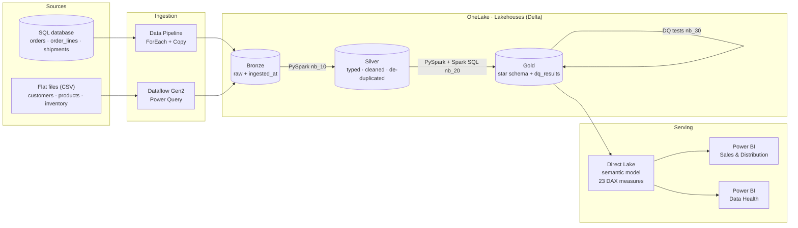
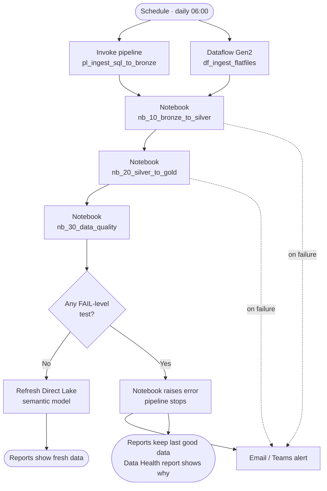
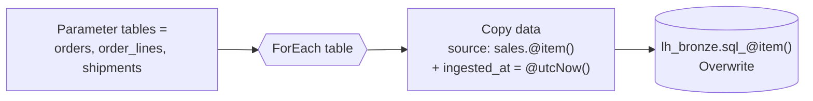
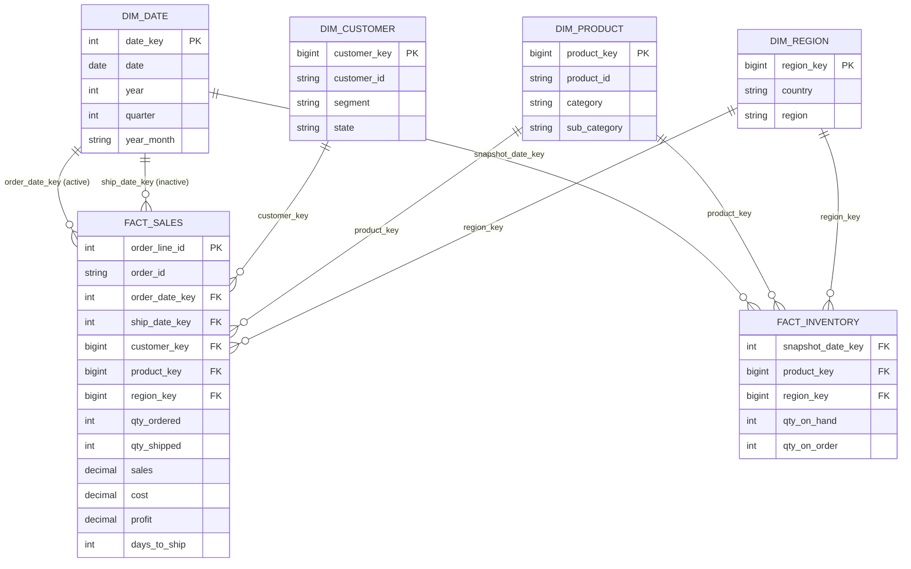
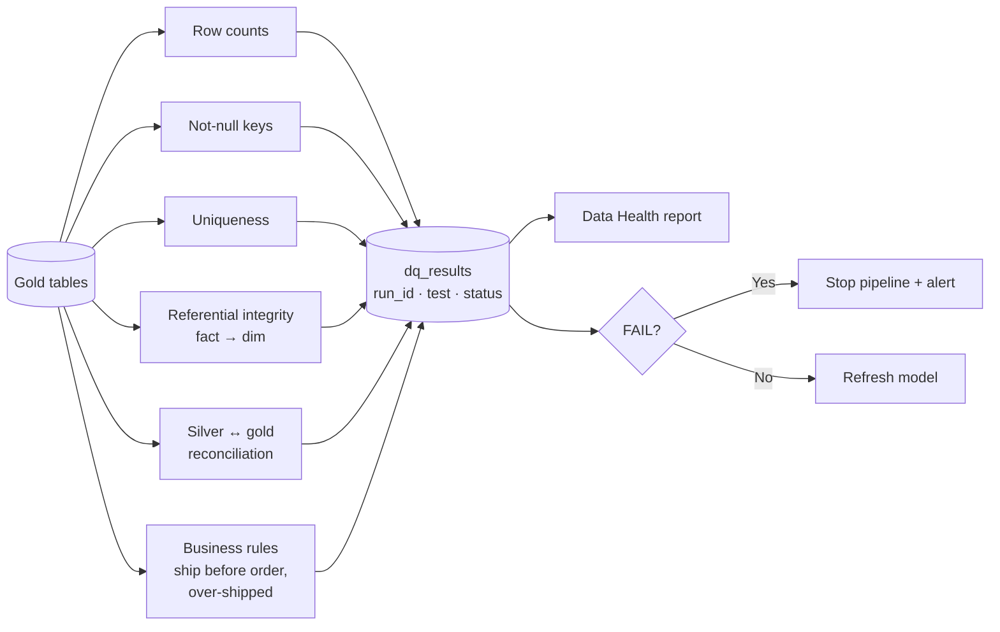
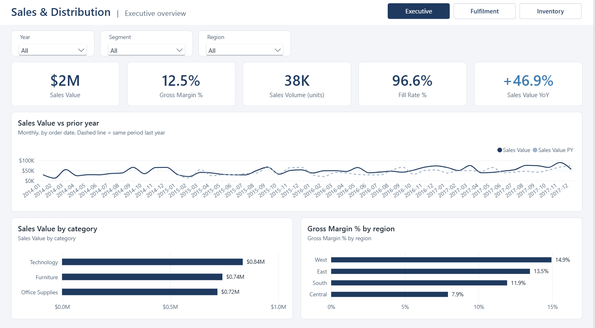
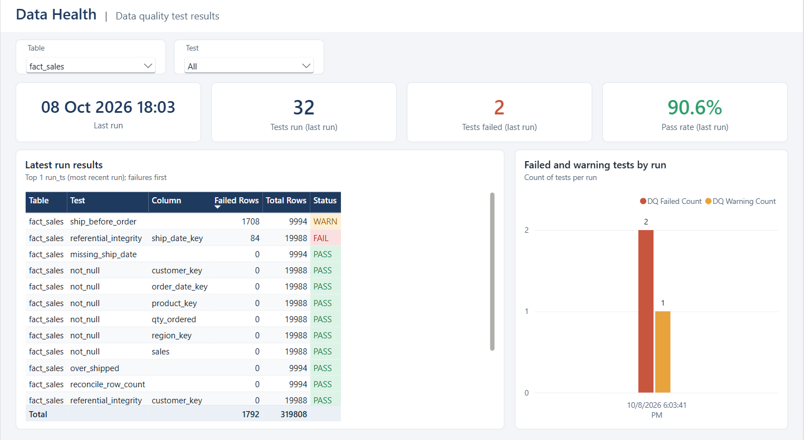
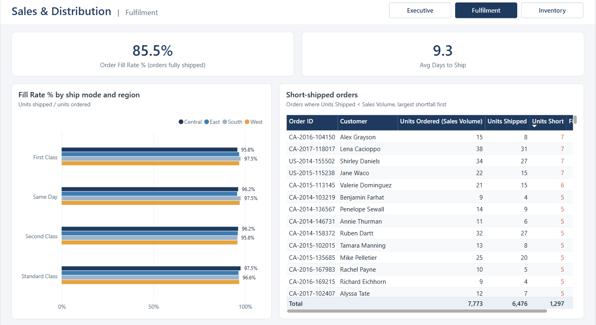
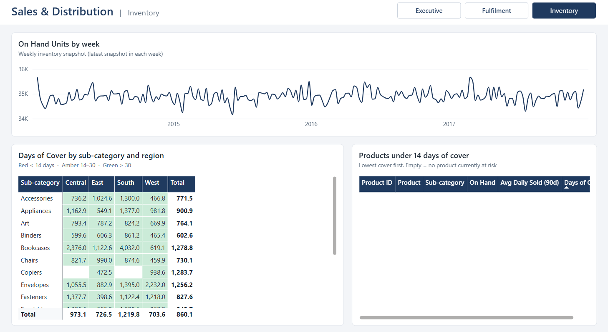

# Sales & Distribution Analytics on Microsoft Fabric

**End-to-end lakehouse analytics platform: ingestion → medallion lakehouse → star schema → Direct Lake semantic model → Power BI, with automated data quality gating.**


---

## At a glance

| | |
| --- | --- |
| **Business problem** | A sales and distribution business needs one trusted view of sales, margin, order fulfilment and stock cover across customers, products and regions. |
| **What I built** | A Microsoft Fabric platform that ingests a SQL database and flat files daily, refines them through bronze / silver / gold layers, models them as a star schema, and serves a Direct Lake Power BI model to self-service users. |
| **Scale** | ~10,000 order lines, ~5,000 orders, ~800 customers, ~1,900 products, ~1.5 M inventory snapshot rows (Superstore dataset + synthesized shipments and inventory). |
| **Outputs** | 6 gold tables, 23 documented DAX measures, 2 Power BI reports (Sales & Distribution, Data Health), 35 automated data quality tests per run. |

## Skills demonstrated

| Area | Skills | Where to look |
| --- | --- | --- |
| **Data engineering** | Medallion architecture, Delta Lake, PySpark, incremental-ready ingestion, de-duplication with window functions | [`notebooks/`](notebooks/) |
| **Data integration** | Fabric Data Pipelines (parameterised ForEach + Copy), Dataflows Gen2 / Power Query M, orchestration, scheduling, failure alerts | [`pipelines/`](pipelines/), [`dataflows/`](dataflows/) |
| **Data modelling** | Kimball star schema, conformed dimensions, facts at two grains, surrogate keys, periodic snapshot fact | [`notebooks/nb_20_silver_to_gold.ipynb`](notebooks/) |
| **SQL** | T-SQL DDL, Spark SQL CTAS, SQL analytics endpoint views | [`sql/`](sql/) |
| **BI & semantic modelling** | Direct Lake semantic model, relationships (incl. inactive role-playing date), DAX time intelligence, semi-additive measures, documented measure catalogue | [`semantic-model/`](semantic-model/) |
| **Data quality & governance** | Row-count, null, uniqueness, referential-integrity, reconciliation and business-rule tests; results logged to Delta; pipeline gating; health report | [`notebooks/nb_30_data_quality.ipynb`](notebooks/) |
| **DevOps practices** | Naming conventions, workspace organisation, source control of all item definitions, reproducible data generation | This repo |

---

## Architecture



| Layer | Fabric item | Purpose |
| --- | --- | --- |
| Source | SQL database `sql_source_sales`, CSV files | Simulated operational system and business-owned files |
| Bronze | Lakehouse `lh_bronze` | Raw, unchanged copies stamped with load time; replayable history |
| Silver | Lakehouse `lh_silver` | Typed, trimmed, de-duplicated; business rules applied once |
| Gold | Lakehouse `lh_gold` | Dimensional model for consumption + DQ log |
| Semantic | `sm_sales_distribution` (Direct Lake) | Reads Delta files in OneLake directly; no import refresh |
| Reporting | Power BI reports | Self-service analytics and data health monitoring |

---

## Daily orchestration flow

One master pipeline runs end to end on a schedule. The semantic model only reframes after data quality passes, so users never see bad data.



---

## Ingestion pattern (bronze)

A single parameterised pipeline copies any number of SQL tables, so adding a table means adding one name to a list.



Flat files go through **Dataflow Gen2** (Power Query) to set headers and data types, preserve leading zeros in postal codes, and add `ingested_at` before landing as `file_*` Delta tables.

---

## Gold data model

Two fact tables at different grains share **conformed** product, region and date dimensions, so one slicer filters sales and stock together.



| Table | Grain | Notes |
| --- | --- | --- |
| `fact_sales` | One order line | Sales, cost, margin, ordered vs shipped units, days to ship |
| `fact_inventory` | Product × region × week | Periodic snapshot; on-hand is semi-additive |
| `dim_date` | Day | Full calendar years; marked as date table; role-plays order and ship date |
| `dim_customer` / `dim_product` / `dim_region` | One member | Hash-based surrogate keys (`xxhash64`) stable across full reloads |

---

## Semantic model & DAX

Direct Lake model with **23 documented measures** (description, format string and display folder on every measure).

| Display folder | Measures |
| --- | --- |
| Sales | Sales Value, Sales Volume, Orders, Avg Order Value |
| Margin | Cost, Gross Margin, Gross Margin % |
| Fulfilment | Units Shipped, **Fill Rate %**, Order Fill Rate %, Avg Days to Ship, Sales Value by Ship Date |
| Inventory | On Hand Units (semi-additive), Avg Daily Units Sold 90d, **Days of Cover** |
| Growth | Sales Value PY, **Sales Value YoY %**, Sales Volume PY, Sales Volume YoY % |
| Data Quality | DQ Last Run, DQ Tests Run, DQ Tests Failed, DQ Pass Rate % |

```dax
On Hand Units =
    CALCULATE (
        SUM ( fact_inventory[qty_on_hand] ),
        LASTNONBLANK ( dim_date[date], CALCULATE ( COUNTROWS ( fact_inventory ) ) )
    )

Days of Cover = DIVIDE ( [On Hand Units], [Avg Daily Units Sold 90d] )

Sales Value YoY % = DIVIDE ( [Sales Value] - [Sales Value PY], [Sales Value PY] )
```

Full catalogue: [`semantic-model/`](semantic-model/).

---

## Automated data quality

Every run executes **35 tests**, appends results to `lh_gold.dq_results`, and stops the pipeline on any error-level failure.



| Test type | Count | Severity |
| --- | --- | --- |
| Row count (all gold tables) | 6 | Error |
| Uniqueness (keys and fact grain) | 7 | Error (source duplicates = Warn) |
| Not-null (fact keys and measures) | 10 | Error |
| Referential integrity (fact → dimension) | 8 | Error |
| Reconciliation (silver vs gold row count) | 1 | Error |
| Business rules | 3 | Warn |

---

## Reports

| Sales & Distribution | Data Health |
| --- | --- |
|  |  |
| Sales, margin, YoY growth, fill rate and days of cover by region, category and customer segment | Latest run results, pass rate and failed-test trend by table and test |

<details>
<summary>More screenshots</summary>





</details>

---

## Repository structure

```
├─ notebooks/        nb_00 generate sources · nb_10 bronze→silver · nb_20 silver→gold · nb_30 data quality
├─ pipelines/        pl_seed_sql_source · pl_ingest_sql_to_bronze · pl_master_daily (JSON)
├─ dataflows/        df_ingest_flatfiles (.pqt) + Power Query M per query
├─ sql/              source DDL · SQL endpoint views
├─ semantic-model/   model definition / measure catalogue
├─ data/sample/      sample input file
└─ docs/images/      report and lineage screenshots
```

| Workspace folder | Items |
| --- | --- |
| `00_Storage` | `lh_bronze`, `lh_silver`, `lh_gold` |
| `01_Sources` | `sql_source_sales`, `nb_00_generate_source_data`, `pl_seed_sql_source` |
| `02_Ingest` | `pl_ingest_sql_to_bronze`, `df_ingest_flatfiles`, `pl_master_daily` |
| `03_Transform` | `nb_10_bronze_to_silver`, `nb_20_silver_to_gold`, `nb_30_data_quality` |
| `04_Model` | `sm_sales_distribution` |
| `05_Reports` | Sales & Distribution, Data Health |

---

## How to reproduce

1. Create a Fabric workspace (trial capacity works) and three lakehouses: `lh_bronze`, `lh_silver`, `lh_gold`.
2. Upload the Superstore workbook to `lh_bronze/Files/seed` and run `nb_00_generate_source_data` to create the CSV sources.
3. Create SQL database `sql_source_sales`, run `sql/source_ddl.sql`, and seed it with `pl_seed_sql_source`.
4. Import `pl_ingest_sql_to_bronze` and `df_ingest_flatfiles` to load bronze.
5. Run `nb_10`, `nb_20`, `nb_30` (or `pl_master_daily`) to build silver, gold and DQ results.
6. Create the Direct Lake semantic model from `lh_gold` and add the measures from `semantic-model/`.
7. Build the reports and schedule `pl_master_daily`.

---

## Design decisions

| Decision | Why |
| --- | --- |
| Three lakehouses (bronze / silver / gold) | Clear separation of raw, cleaned and modelled data; each layer independently testable and replayable |
| Pipeline for SQL, Dataflow Gen2 for files | Pipelines move structured tables at scale; Power Query suits business-owned files needing shaping |
| Region-grain `dim_region` | Inventory is only known by region, so this grain keeps the dimension conformed across both facts |
| Hash surrogate keys | Deterministic across full reloads, no key-lookup table; uniqueness tests guard against collisions |
| Direct Lake | No import copy or long refresh; model reads V-Ordered Delta files in OneLake |
| DQ-gated model refresh | Auto-sync disabled so the model reframes only after tests pass |

## Next steps

- Incremental (watermark-based) loads using `modified_at`
- Row-level security by region
- Deployment pipelines (Dev → Test → Prod)
- Activator alerts on `DQ Tests Failed > 0`

---

### About the data

Built on the public **Sample Superstore** dataset. Shipments (including short-shipments) and weekly inventory snapshots are **synthesized** by `nb_00_generate_source_data` to simulate a distribution business; generated CSVs are not committed and can be recreated by running that notebook.

**Author:** chamod gavindya · [LinkedIn](https://www.linkedin.com/in/chamod-gavindya) · [GitHub]((https://github.com/Chamod-G))
